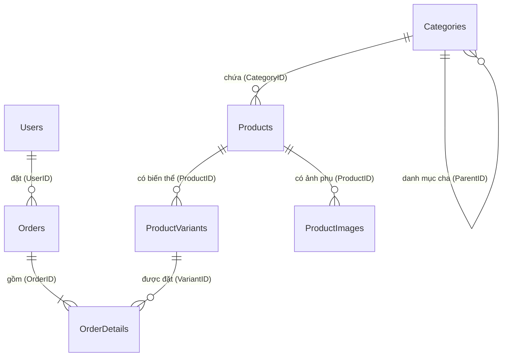
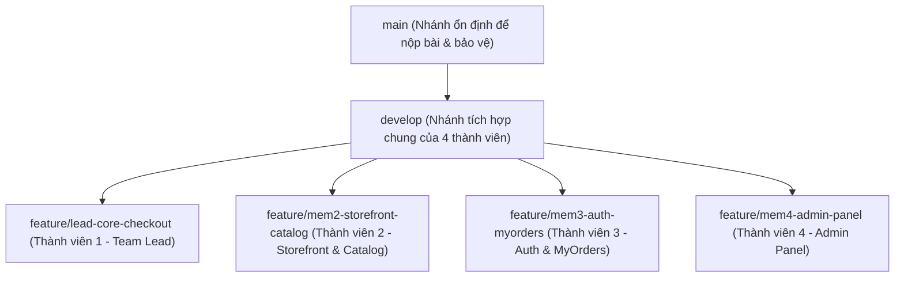

# 🛍️ NOVA.VN (NovaShop) — Website Bán Quần Áo Thời Trang Hiện Đại

> **Đề tài Bài Tập Lớn (BTL):** Thiết kế & Lập trình Web — **ASP.NET Web Forms (.NET Framework 4.7.2)** + **Entity Framework 6 (Code First / LINQ)** + **Tailwind CSS**.  
> **Quy mô nhóm:** 4 Thành viên (1 Team Lead / Architect + 3 Developers) làm việc theo mô hình **Git Feature Branch Workflow**.

---

## 📌 Mục lục
1. [Giới thiệu hệ thống & Điểm nổi bật](#-1-giới-thiệu-hệ-thống--điểm-nổi-bật)
2. [Kiến trúc Kỹ thuật & Công nghệ sử dụng](#-2-kiến-trúc-kỹ-thuật--công-nghệ-sử-dụng)
3. [Chức năng hệ thống theo 3 Vai trò](#-3-chức-năng-hệ-thống-theo-3-vai-trò)
4. [Thiết kế Cơ sở dữ liệu (Chuẩn 3NF - 7 Bảng)](#-4-thiết-kế-cơ-sở-dữ-liệu-chuẩn-3nf---7-bảng)
5. [Cấu trúc Thư mục Codebase](#-5-cấu-trúc-thư-mục-codebase)
6. [Hướng dẫn Cài đặt & Chạy Dự án (Quick Start)](#-6-hướng-dẫn-cài-đặt--chạy-dự-án-quick-start)
7. [Phân công Công việc & Quyền sở hữu File (4 Thành viên)](#-7-phân-công-công-việc--quyền-sở-hữu-file-4-thành-viên)
8. [Hướng dẫn Chia nhánh Git & Quy trình làm việc nhóm](#-8-hướng-dẫn-chia-nhánh-git--quy-trình-làm-việc-nhóm)
9. [Tài liệu Chi tiết trong thư mục `docs/`](#-9-tài-liệu-chi-tiết-trong-thư-mục-docs)

---

## ✨ 1. Giới thiệu hệ thống & Điểm nổi bật

**NOVA.VN (`NovaShop`)** là hệ thống thương mại điện tử chuyên biệt cho ngành hàng **Thời trang & Quần áo**, được thiết kế với các tiêu chuẩn thực tế:

- **Quản lý Biến thể Thời trang thực tế (`ProductVariants`):** Mỗi mẫu quần áo (`Product`) không chỉ có tên và giá, mà được chia thành các biến thể cụ thể theo **Màu sắc (`Đen`, `Trắng Kem`, `Be Cát`...)** và **Kích cỡ (`S`, `M`, `L`, `XL`)**, quản lý mã `SKU` và số lượng tồn kho (`StockQuantity`) riêng biệt cho từng Size/Màu.
- **Tự động khởi tạo CSDL & Seed Data (`ShopDbInitializer`):** Ngay lần chạy đầu tiên (`F5` trong Visual Studio), Entity Framework 6 tự động khởi tạo cơ sở dữ liệu `NovaShopDB` trên SQL Server kèm theo:
  - **2 tài khoản mẫu** (Admin & Khách hàng) đã mã hóa mật khẩu `SHA-256`.
  - **8 danh mục thời trang** chuẩn thanh điều hướng (`ÁO THUN`, `ÁO SƠ MI`, `ÁO KHOÁC`, `QUẦN JEANS`, `QUẦN DÀI`, `QUẦN TÂY`, `QUẦN SHORT`, `PHỤ KIỆN`).
  - **20 sản phẩm quần áo mẫu** kèm ảnh chất lượng cao và **240 biến thể Size/Màu** (`NV-...`) sẵn sàng để demo.
  - **1 đơn hàng mẫu** để kiểm thử ngay giao diện Admin và Lịch sử đơn hàng.
- **Đặt hàng an toàn với EF6 Database Transaction:** Khi khách đặt hàng (`OrderService.CreateOrderFromCart`), hệ thống khóa giao dịch (`BeginTransaction`), kiểm tra tồn kho thực tế, tạo `Order` + `OrderDetails` và tự động trừ `StockQuantity` của đúng biến thể Size/Màu. Nếu hết hàng hoặc có lỗi, toàn bộ giao dịch được `Rollback` an toàn.
- **Giao diện Editorial Minimalist với Tailwind CSS:** Loại bỏ sự cứng nhắc của Bootstrap truyền thống, sử dụng **Tailwind CSS** kết hợp `<asp:Repeater>` để kiểm soát 100% HTML sạch, hiện đại, chuẩn Responsive trên Mobile & Desktop.

---

## 🛠 2. Kiến trúc Kỹ thuật & Công nghệ sử dụng

| Tầng / Thành phần | Công nghệ áp dụng | Mô tả vai trò trong hệ thống |
| :--- | :--- | :--- |
| **Presentation Layer (UI)** | **ASP.NET Web Forms** (`MasterPage`, `Repeater`, Server Controls) + **Tailwind CSS** | Tách biệt giao diện Khách hàng (`Site.Master`) và Quản trị (`Admin/Admin.Master`). |
| **Business / Service Layer** | **C# Static Services (`Services/*`)** | Đóng gói toàn bộ logic nghiệp vụ: `AuthService`, `CatalogService`, `CartService`, `OrderService`. |
| **Data Access Layer (ORM)** | **Entity Framework 6 (`EntityFramework 6.4.4`)** | Truy vấn bằng **LINQ to Entities**, chống SQL Injection 100%, quản lý quan hệ bằng Navigation Properties. |
| **Database** | **Microsoft SQL Server** (`LocalDB` hoặc `SQLEXPRESS`) | CSDL `NovaShopDB` chuẩn 3NF; có kèm script `Database/InitShopDB.sql` độc lập. |
| **Bảo mật (Security)** | **SHA-256 Password Hashing** + Session Role Guard | Mật khẩu không bao giờ lưu dạng thô; kiểm tra phân quyền `Admin` tập trung tại `Admin.Master`. |

---

## 👥 3. Chức năng hệ thống theo 3 Vai trò

### 1️⃣ Khách vãng lai (`Guest`)
- **Trang chủ (`Default.aspx`):** Header sticky hiện đại, Hero Banner phong cách Editorial, danh sách sản phẩm Nổi bật & Mới nhất.
- **Khám phá & Lọc sản phẩm (`Products.aspx`):** Lọc theo danh mục (`?cat=`), lọc sản phẩm khuyến mãi (`?sale=1`), tìm kiếm theo từ khóa (`?kw=`), sắp xếp theo giá tăng/giảm/mới nhất và phân trang.
- **Chi tiết sản phẩm (`ProductDetail.aspx`):** Xem thông tin chi tiết, chọn **Màu sắc & Kích cỡ (`S/M/L/XL`)**, kiểm tra tồn kho theo từng biến thể và thêm vào giỏ hàng.
- **Giỏ hàng (`Cart.aspx`):** Lưu trữ trên `Session["Cart"]`, cập nhật số lượng (có kiểm tra trần tồn kho `MaxStock`), xóa món, tự động tính tổng tiền.

### 2️⃣ Khách hàng thành viên (`Customer`)
- **Đăng ký (`Register.aspx`) & Đăng nhập (`Login.aspx`):** Kiểm tra trùng Email, băm mật khẩu `SHA-256`, tự động chuyển hướng thông minh (`returnUrl`).
- **Thanh toán & Đặt hàng (`Checkout.aspx`):** Tự động điền thông tin người nhận từ tài khoản, tạo đơn hàng qua EF6 Transaction và trừ tồn kho biến thể.
- **Đơn hàng của tôi (`MyOrders.aspx`):** Theo dõi lịch sử các đơn hàng đã đặt, xem chi tiết từng sản phẩm (Size/Màu/Đơn giá), hỗ trợ **Hủy đơn hàng** khi đơn đang ở trạng thái *Chờ xử lý (`Pending`)* (hệ thống tự động hoàn lại số lượng tồn kho).

### 3️⃣ Quản trị viên (`Admin`)
- **Bảo vệ phân quyền (`Admin/Admin.Master`):** Tự động chặn người dùng chưa đăng nhập hoặc không phải `Role == "Admin"`.
- **Dashboard tổng quan (`Admin/Default.aspx`):** Thống kê tổng doanh thu, số lượng đơn hàng, số sản phẩm đang kinh doanh và cảnh báo các biến thể sắp hết hàng.
- **Quản lý Danh mục (`Admin/Categories.aspx`):** Thêm, sửa, ẩn/hiện, sắp xếp thứ tự hiển thị danh mục trên thanh menu.
- **Quản lý Sản phẩm (`Admin/Products.aspx`):** Thêm/sửa/ẩn sản phẩm, quản lý giá gốc - giá sale, upload hình ảnh đại diện.
- **Quản lý Biến thể Size/Màu (`Admin/ProductVariants.aspx`):** Quản lý mã SKU, Màu sắc, Size (`S, M, L, XL`) và cập nhật số lượng tồn kho cho từng mẫu quần áo.
- **Quản lý Đơn hàng (`Admin/Orders.aspx`):** Lọc đơn hàng theo trạng thái, xem chi tiết đơn và cập nhật luồng trạng thái (*Chờ xử lý `Pending` → Đang giao `Shipping` → Hoàn thành `Completed` / Đã hủy `Cancelled`*).

---

## 🗄 4. Thiết kế Cơ sở dữ liệu (Chuẩn 3NF - 7 Bảng)



- **`Users`**: Tài khoản Khách hàng & Admin (`UserID`, `FullName`, `Email`, `PasswordHash`, `Phone`, `Address`, `Role`, `IsActive`, `CreatedAt`).
- **`Categories`**: Danh mục sản phẩm (`CategoryID`, `CategoryName`, `Slug`, `ParentID`, `DisplayOrder`, `IsActive`).
- **`Products`**: Thông tin chung mẫu quần áo (`ProductID`, `CategoryID`, `ProductName`, `Price`, `SalePrice`, `Thumbnail`, `Description`, `IsFeatured`, `IsActive`, `CreatedAt`).
- **`ProductVariants`**: Biến thể Size/Màu & Tồn kho (`VariantID`, `ProductID`, `SKU`, `ColorName`, `SizeName`, `StockQuantity`).
- **`ProductImages`**: Ảnh phụ của sản phẩm (`ImageID`, `ProductID`, `ImageUrl`, `SortOrder`).
- **`Orders`**: Đơn đặt hàng (`OrderID`, `UserID`, `CustomerName`, `CustomerPhone`, `ShippingAddress`, `Note`, `TotalAmount`, `OrderStatus`, `OrderDate`).
- **`OrderDetails`**: Chi tiết từng món trong đơn gắn với `VariantID` (`OrderDetailID`, `OrderID`, `VariantID`, `Quantity`, `UnitPrice`).

---

## 📂 5. Cấu trúc Thư mục Codebase

```text
novashop/
├── NovaShop.sln                        # File Solution Visual Studio
├── NovaShop.csproj                     # File Project ASP.NET Web Forms (.NET 4.7.2)
├── Web.config                          # Cấu hình ConnectionString "ShopDbContext" & EF6
├── packages.config                     # Khai báo NuGet package EntityFramework 6.4.4
├── Global.asax / Global.asax.cs        # Kích hoạt ShopDbInitializer tự tạo DB & Seed Data
│
├── Models/                             # [TEAM LEAD QUẢN LÝ] Các lớp Entity EF6 & DbContext
│   ├── ShopDbContext.cs                # Lớp DbContext chính kết nối SQL Server
│   ├── ShopDbInitializer.cs            # Tự động tạo DB + Seed 20 sản phẩm & 240 biến thể
│   ├── User.cs, Category.cs, Product.cs, ProductVariant.cs, ProductImage.cs
│   ├── Order.cs, OrderDetail.cs
│   └── CartItem.cs                     # ViewModel giỏ hàng lưu trong Session["Cart"]
│
├── Services/                           # Tầng xử lý nghiệp vụ dùng LINQ to Entities
│   ├── AuthService.cs                  # Đăng ký, Đăng nhập, Hash SHA-256, Phân quyền
│   ├── CatalogService.cs               # Truy vấn Danh mục, Sản phẩm, Bộ lọc & Phân trang
│   ├── CartService.cs                  # Quản lý giỏ hàng Session["Cart"] & kiểm tra tồn kho
│   └── OrderService.cs                 # Đặt hàng EF6 Transaction, Hủy đơn & Duyệt trạng thái
│
├── Site.Master / Site.Master.cs        # Layout chung phía Khách hàng (Tailwind CSS)
├── Default.aspx(.cs)                   # Trang chủ NOVA.VN
├── Products.aspx(.cs)                  # Danh sách sản phẩm, lọc, tìm kiếm, phân trang
├── ProductDetail.aspx(.cs)             # Chi tiết sản phẩm & chọn Màu sắc / Kích cỡ
├── Cart.aspx(.cs)                      # Giỏ hàng
├── Checkout.aspx(.cs)                  # Thanh toán & Đặt hàng
├── Login.aspx(.cs)                     # Đăng nhập
├── Register.aspx(.cs)                  # Đăng ký tài khoản
├── MyOrders.aspx(.cs)                  # Lịch sử đơn hàng của khách
│
├── Admin/                              # Phân hệ Quản trị hệ thống
│   ├── Admin.Master(.cs)               # Layout Admin + Chặn quyền truy cập
│   ├── Default.aspx(.cs)               # Dashboard thống kê
│   ├── Categories.aspx(.cs)            # CRUD Danh mục
│   ├── Products.aspx(.cs)              # CRUD Sản phẩm
│   ├── ProductVariants.aspx(.cs)       # CRUD Biến thể Size / Màu / Tồn kho
│   └── Orders.aspx(.cs)                # Quản lý & Duyệt đơn hàng
│
├── Assets/                             # Tài nguyên tĩnh (CSS, JS, Hình ảnh)
│   ├── css/custom.css
│   └── js/main.js
│
├── Database/
│   └── InitShopDB.sql                  # Script SQL Server khởi tạo thủ công (kèm Seed Data)
│
└── docs/                               # Tài liệu thiết kế, lộ trình & quy tắc làm việc nhóm
    ├── 01_TONG_QUAN_DU_AN.md
    ├── 02_CAC_GIAI_DOAN_DU_AN.md
    └── 03_PHAN_CONG_VA_QUY_TAC_GIT.md
```

---

## 🚀 6. Hướng dẫn Cài đặt & Chạy Dự án (Quick Start)

### Yêu cầu môi trường
- **Visual Studio 2019 / 2022** (có cài workload *ASP.NET and web development*).
- **.NET Framework 4.7.2** Developer Pack.
- **SQL Server LocalDB** (đi kèm sẵn với Visual Studio) hoặc **SQL Server Express (`.\SQLEXPRESS`)**.

### Các bước chạy dự án
1. **Clone repository về máy:**
   ```bash
   git clone https://github.com/khoaa0901021168zzzzz-ship-it/novashop.git
   cd novashop
   ```
2. **Mở Solution:** Mở file `NovaShop.sln` bằng Visual Studio.
3. **Khôi phục gói NuGet (`EntityFramework 6.4.4`):**
   - Trong Visual Studio, chuột phải vào Solution `NovaShop` → chọn **Restore NuGet Packages** (hoặc bấm `Ctrl + Shift + B` để Build, Visual Studio sẽ tự tải gói `EntityFramework.6.4.4`).
4. **Chạy dự án (`F5` hoặc `Ctrl + F5`):**
   - Mặc định `Web.config` sử dụng `(localdb)\MSSQLLocalDB` với tên CSDL là `NovaShopDB`.
   - Khi chạy lần đầu, `ShopDbInitializer` trong `Global.asax.cs` sẽ **tự động tạo CSDL `NovaShopDB` và nạp sẵn 20 sản phẩm + 240 biến thể + tài khoản mẫu**.
   - *(Tùy chọn)* Nếu máy bạn dùng `.\SQLEXPRESS`, bạn có thể chạy file `Database/InitShopDB.sql` trong SSMS hoặc đổi `Data Source=.\SQLEXPRESS` trong `Web.config`.

### 🔑 Tài khoản mẫu có sẵn (Seed Data)

| Vai trò | Email đăng nhập | Mật khẩu | Quyền hạn |
| :--- | :--- | :--- | :--- |
| **Quản trị viên (Admin)** | `admin@nova.vn` | `123456` | Truy cập toàn bộ `/Admin/*` và ngoài trang chủ |
| **Khách hàng (Customer)** | `khach@gmail.com` | `123456` | Mua sắm, đặt hàng, xem `/MyOrders.aspx` (đã có sẵn 1 đơn mẫu) |

---

## 🤝 7. Phân công Công việc & Quyền sở hữu File (4 Thành viên)

Để **tuyệt đối không xảy ra xung đột (Merge Conflict)** trên file `.csproj`, `Web.config` và `ShopDbContext.cs`, toàn bộ khung file `.aspx` và tầng `Models/` đã được khởi tạo sẵn. Mỗi thành viên chỉ làm việc trên đúng nhóm file được phân công:

| Thành viên | Nhánh Git (`Branch`) | Tỷ trọng | Phụ trách Chức năng | Danh sách File ĐƯỢC PHÉP SỬA (File Ownership) |
| :--- | :--- | :---: | :--- | :--- |
| **Thành viên 1**<br>**Team Lead / Architect** | `feature/lead-core-checkout` | **~35-40%** | - Thiết kế CSDL, EF6 `Models/*`, `ShopDbContext`, `ShopDbInitializer` (Seed Data).<br>- Dựng khung `Site.Master` & `Admin/Admin.Master`.<br>- Xây dựng `CartService`, `OrderService` (EF6 Transaction).<br>- Trang Giỏ hàng (`Cart.aspx`) & Đặt hàng (`Checkout.aspx`).<br>- Quản lý nhánh `develop` & `main`, review PR. | - `Web.config`, `Global.asax(.cs)`, `NovaShop.csproj`<br>- `Database/InitShopDB.sql`<br>- Toàn bộ `Models/*`<br>- `Site.Master(.cs)`, `Admin/Admin.Master(.cs)`<br>- `Services/CartService.cs`, `Services/OrderService.cs`<br>- `Cart.aspx(.cs)`, `Checkout.aspx(.cs)` |
| **Thành viên 2**<br>**Storefront & Catalog Dev** | `feature/mem2-storefront-catalog` | **~20%** | - Trang chủ (`Default.aspx`): Hero banner, 3 banner chiến dịch, lưới sản phẩm nổi bật & mới.<br>- Danh sách sản phẩm (`Products.aspx`): Lọc theo danh mục, lọc đồ SALE, tìm kiếm từ khóa, sắp xếp giá & phân trang.<br>- Chi tiết sản phẩm (`ProductDetail.aspx`): Chọn Màu sắc & Size (`S/M/L/XL`), hiển thị tồn kho và thêm vào giỏ. | - `Services/CatalogService.cs`<br>- `Default.aspx`, `Default.aspx.cs`<br>- `Products.aspx`, `Products.aspx.cs`<br>- `ProductDetail.aspx`, `ProductDetail.aspx.cs`<br>- `Assets/css/custom.css`, `Assets/js/main.js` |
| **Thành viên 3**<br>**Auth & Customer Portal Dev** | `feature/mem3-auth-myorders` | **~20%** | - Đăng ký (`Register.aspx`): Kiểm tra dữ liệu, chống trùng Email, băm mật khẩu `SHA-256`.<br>- Đăng nhập / Đăng xuất (`Login.aspx`): Xác thực EF6, lưu `Session["User"]`, điều hướng theo quyền.<br>- Đơn hàng của tôi (`MyOrders.aspx`): Xem danh sách & chi tiết đơn hàng đã đặt, chức năng **Hủy đơn hàng** (`Pending`) & hoàn tồn kho. | - `Services/AuthService.cs`<br>- `Login.aspx`, `Login.aspx.cs`<br>- `Register.aspx`, `Register.aspx.cs`<br>- `MyOrders.aspx`, `MyOrders.aspx.cs` |
| **Thành viên 4**<br>**Admin Panel & Dashboard Dev** | `feature/mem4-admin-panel` | **~20%** | - Dashboard thống kê (`Admin/Default.aspx`): Tổng doanh thu, số đơn, cảnh báo sắp hết hàng.<br>- CRUD Danh mục (`Admin/Categories.aspx`).<br>- CRUD Sản phẩm & Upload ảnh (`Admin/Products.aspx`).<br>- Quản lý Biến thể Size/Màu/Tồn kho (`Admin/ProductVariants.aspx`).<br>- Quản lý & Duyệt trạng thái Đơn hàng (`Admin/Orders.aspx`). | - `Admin/Default.aspx(.cs)`<br>- `Admin/Categories.aspx(.cs)`<br>- `Admin/Products.aspx(.cs)`<br>- `Admin/ProductVariants.aspx(.cs)`<br>- `Admin/Orders.aspx(.cs)` |

---

## 🌿 8. Hướng dẫn Chia nhánh Git & Quy trình làm việc nhóm

### A. Sơ đồ Nhánh (Branches) đã được tạo sẵn trên Repository



Trên kho GitHub này đã được tạo sẵn **6 nhánh chuẩn**:
- `main`: Nhánh chính chứa phiên bản ổn định để báo cáo/bảo vệ.
- `develop`: Nhánh tích hợp code chung của cả nhóm.
- `feature/lead-core-checkout`: Nhánh làm việc của **Thành viên 1 (Team Lead)**.
- `feature/mem2-storefront-catalog`: Nhánh làm việc của **Thành viên 2**.
- `feature/mem3-auth-myorders`: Nhánh làm việc của **Thành viên 3**.
- `feature/mem4-admin-panel`: Nhánh làm việc của **Thành viên 4**.

### B. Các lệnh Git dành cho từng Thành viên khi bắt đầu làm việc

1. **Lần đầu tiên lấy dự án về máy:**
   ```bash
   git clone https://github.com/khoaa0901021168zzzzz-ship-it/novashop.git
   cd novashop

   # Chuyển sang đúng nhánh được giao cho mình (ví dụ Thành viên 2):
   git checkout feature/mem2-storefront-catalog
   ```

2. **Quy trình 5 bước mỗi ngày khi code:**
   ```bash
   # Bước 1: Luôn kéo code mới nhất từ nhánh develop về trước khi code
   git pull origin develop

   # Bước 2: Mở Visual Studio, chỉ sửa trong các file được phân công và Build thử (Ctrl + Shift + B)

   # Bước 3: Kiểm tra các file đã thay đổi
   git status

   # Bước 4: Add đúng các file của mình, commit và push lên nhánh cá nhân
   git add .
   git commit -m "feat(module): mo ta ngan gon cong viec vua hoan thanh"
   git push origin <tên-nhánh-của-bạn>

   # Bước 5: Lên GitHub tạo Pull Request (PR) từ nhánh cá nhân vào nhánh develop để Team Lead review & merge
   ```

---

## 📚 9. Tài liệu Chi tiết trong thư mục `docs/`

Toàn bộ tài liệu phục vụ phát triển và viết Báo cáo Word BTL nằm trong thư mục [`docs/`](./docs):
- 📄 [**`docs/01_TONG_QUAN_DU_AN.md`**](./docs/01_TONG_QUAN_DU_AN.md): Phân tích yêu cầu, ma trận chức năng MVP vs. Mở rộng, sơ đồ Use Case, sơ đồ ERD 3NF và định hướng giao diện Tailwind CSS.
- 📄 [**`docs/02_CAC_GIAI_DOAN_DU_AN.md`**](./docs/02_CAC_GIAI_DOAN_DU_AN.md): Lộ trình 8 giai đoạn triển khai dự án từ phân tích, thiết kế CSDL, code song song đến kiểm thử tích hợp và bảo vệ.
- 📄 [**`docs/03_PHAN_CONG_VA_QUY_TAC_GIT.md`**](./docs/03_PHAN_CONG_VA_QUY_TAC_GIT.md): Bảng phân công chi tiết 4 người, quy định File Ownership, quy tắc Git chống conflict và Coding Conventions.
