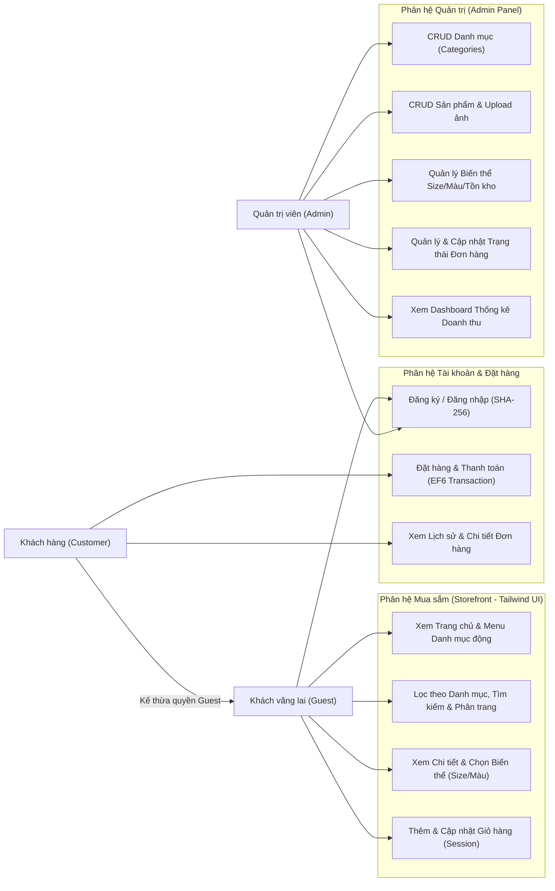
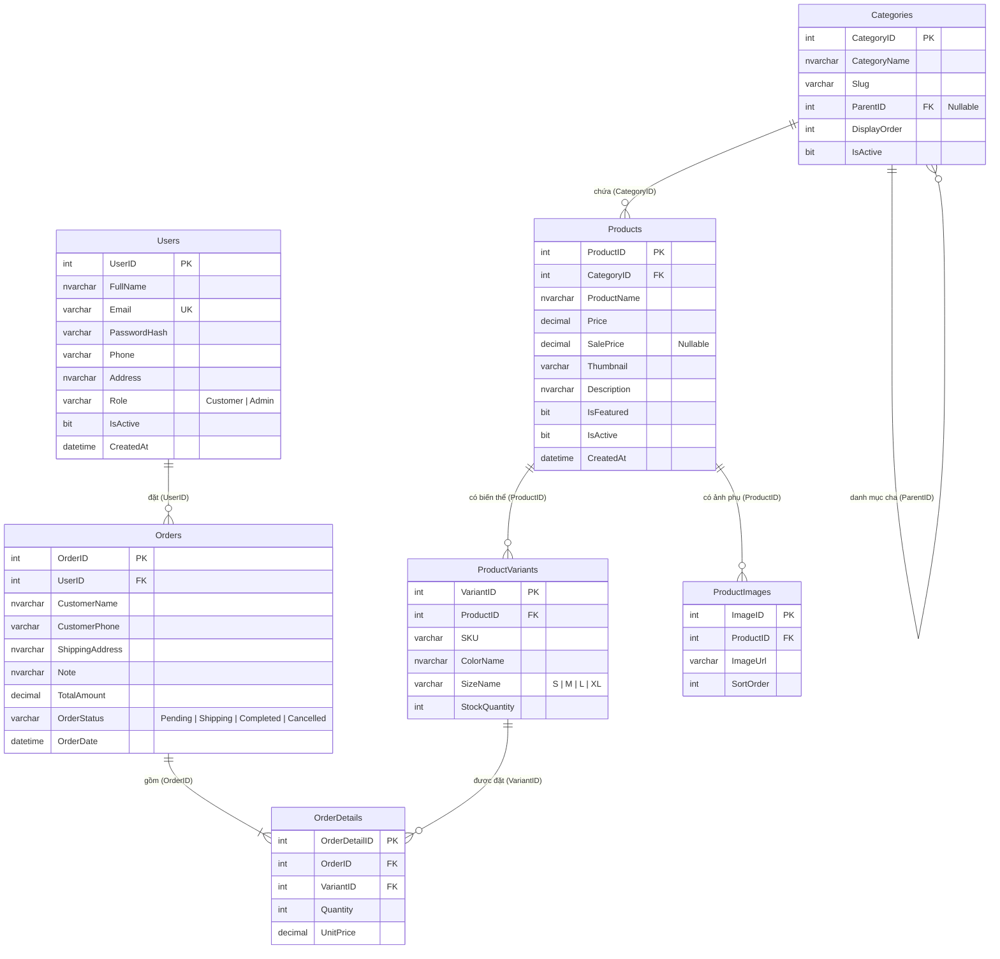

# 01. TỔNG QUAN DỰ ÁN & KIẾN TRÚC KỸ THUẬT
**Đề tài:** Website Bán Quần Áo Thời Trang (Tham khảo giao diện **NOVA.VN**)  
**Loại hình dự án:** Bài Tập Lớn (BTL) Thiết kế & Lập trình Web — ASP.NET Web Forms  
**Quy mô nhóm:** 4 thành viên (1 Team Lead / Quản lý + 3 Thành viên phát triển)

---

## 1. Công nghệ sử dụng (Tech Stack đã chốt)

| Thành phần | Công nghệ / Thư viện | Lý do lựa chọn & Cách áp dụng trong Web Forms |
| :--- | :--- | :--- |
| **Backend Framework** | **ASP.NET Web Forms** (`.NET Framework 4.7.2 / 4.8`, C#) | Chuẩn yêu cầu môn học, sử dụng `MasterPage`, `Repeater`, `ListView` để kiểm soát HTML sạch. |
| **ORM & Truy cập CSDL** | **Entity Framework 6 (EF6 - Code First hoặc Database First với `DbContext`)** | Truy vấn bằng **LINQ to Entities** ngắn gọn, an toàn 100% trước SQL Injection, quản lý quan hệ `Product -> ProductVariants` và `Order -> OrderDetails` cực kỳ trực quan thông qua Navigation Properties. |
| **Cơ sở dữ liệu** | **Microsoft SQL Server** | Lưu trữ dữ liệu quan hệ chuẩn 3NF, có file script `.sql` và Data Seeder khởi tạo sẵn 25+ sản phẩm thời trang. |
| **CSS Framework** | **Tailwind CSS** (Không dùng Bootstrap) | Dựng giao diện tối giản, sắc nét chuẩn phong cách **NOVA.VN** (Editorial fashion, lưới sản phẩm hiện đại, typography Serif + Sans-serif, dễ tùy biến hover/transition mà không bị trùng lặp giao diện Bootstrap truyền thống). |
| **Icon & Fonts** | **Lucide Icons / Heroicons (SVG)** + Google Fonts (`Playfair Display` & `Inter`) | Đúng tinh thần thanh menu mảnh, tinh tế của NOVA.VN trong ảnh thiết kế mẫu. |
| **Quản lý mã nguồn** | **Git & GitHub / GitLab** | Làm việc nhóm 4 người theo mô hình **Feature Branch + Pull Request**, phân quyền rõ file nào ai được phép sửa để tránh xung đột (conflict) file `.csproj` và `DbContext`. |

> **Lưu ý kỹ thuật khi dùng Tailwind CSS trong ASP.NET Web Forms:**
> - Tránh dùng `GridView` mặc định ở phía Khách hàng vì `GridView` tự sinh thẻ `<table>` với inline style rất khó gắn class Tailwind. Thay vào đó, **100% giao diện Khách hàng dùng `<asp:Repeater>` hoặc `<asp:ListView>`** để viết thuần thẻ `<div>` gắn class Tailwind (`grid grid-cols-2 md:grid-cols-4 gap-6`).
> - Tích hợp Tailwind qua **Tailwind Play CDN (kèm config custom font/color trong `Site.Master` và `Admin.Master`)** hoặc **Tailwind CLI standalone** biên dịch ra `Assets/css/tailwind.output.css` để không bắt Visual Studio phải cài Node.js phức tạp trên máy từng thành viên.

---

## 2. Vai trò người dùng & Ma trận Chức năng (MVP vs. Mở rộng)

### A. Ba vai trò trong hệ thống
1. **Khách vãng lai (Guest):** Người dùng truy cập website, xem bộ sưu tập, lọc theo danh mục, tìm kiếm, xem chi tiết sản phẩm (chọn Size/Màu) và thêm sản phẩm vào giỏ hàng (`Session`).
2. **Khách hàng (Customer):** Người dùng đã đăng ký và đăng nhập tài khoản. Thực hiện đặt hàng (Checkout), xem lịch sử đơn hàng, theo dõi trạng thái giao hàng và quản lý thông tin cá nhân.
3. **Quản trị viên (Admin):** Quản lý toàn bộ danh mục, sản phẩm, biến thể Size/Màu/Tồn kho, duyệt đơn hàng và xem thống kê doanh thu.

### B. Danh sách chức năng chi tiết

| Phân hệ | Chức năng Bắt buộc (MVP - Bắt buộc hoàn thành 100%) | Chức năng Mở rộng (Làm thêm để lấy điểm tối đa) |
| :--- | :--- | :--- |
| **1. Khách (Guest)** | - **Trang chủ (`Default.aspx`):** Header sticky kiểu NOVA, Hero Editorial, 3 Banner chiến dịch lớn, danh sách sản phẩm Mới & Nổi bật.<br>- **Danh sách sản phẩm (`Products.aspx`):** Lọc theo danh mục (`CategoryID`), lọc hàng `SALE`, tìm kiếm theo từ khóa, phân trang.<br>- **Chi tiết sản phẩm (`ProductDetail.aspx`):** Xem nhiều ảnh, mô tả chất liệu, chọn **Màu sắc** & **Kích cỡ (Size S/M/L/XL)**, hiển thị tồn kho theo biến thể.<br>- **Giỏ hàng (`Cart.aspx`):** Lưu trong `Session["Cart"]`, thêm/sửa số lượng/xóa món, tự động tính tổng tiền. | - Bộ lọc kết hợp (Khoảng giá + Sắp xếp Giá tăng/giảm/Mới nhất).<br>- Gợi ý "Sản phẩm liên quan cùng danh mục" ở cuối trang chi tiết. |
| **2. Khách hàng (Customer)** | - **Đăng ký (`Register.aspx`) & Đăng nhập (`Login.aspx`):** Kiểm tra dữ liệu hợp lệ, băm mật khẩu `SHA-256` (không lưu mật khẩu thô).<br>- **Thanh toán & Đặt hàng (`Checkout.aspx`):** Tự điền thông tin từ tài khoản, lưu đồng thời `Order` + `OrderDetails` qua EF6 Transaction, tự động trừ tồn kho `StockQuantity` trong bảng `ProductVariants`.<br>- **Đơn hàng của tôi (`MyOrders.aspx`):** Xem danh sách đơn đã đặt và chi tiết từng món (Size, Màu, Đơn giá, Trạng thái). | - Cho phép Khách hàng bấm **"Hủy đơn hàng"** khi đơn đang ở trạng thái *Chờ xử lý (`Pending`)* (tự động hoàn lại tồn kho).<br>- Trang hồ sơ cá nhân (`Profile.aspx`) cập nhật địa chỉ, SĐT, đổi mật khẩu.<br>- Áp mã giảm giá (`Coupons`) khi thanh toán. |
| **3. Quản trị (Admin)** | - **Bảo mật & Phân quyền (`Admin.Master`):** Chặn toàn bộ truy cập vào `/Admin/*` nếu chưa đăng nhập hoặc `Role != "Admin"`.<br>- **Quản lý Danh mục (`Admin/Categories.aspx`):** Thêm, sửa, ẩn/hiện, sắp xếp thứ tự hiển thị trên thanh menu.<br>- **Quản lý Sản phẩm (`Admin/Products.aspx`):** CRUD sản phẩm, upload ảnh đại diện, bật/tắt trạng thái Nổi bật / Đang bán.<br>- **Quản lý Biến thể (`Admin/ProductVariants.aspx`):** Thêm/sửa Size (`S, M, L, XL`), Màu sắc và Số lượng tồn kho cho từng sản phẩm.<br>- **Quản lý Đơn hàng (`Admin/Orders.aspx`):** Lọc đơn theo trạng thái, xem chi tiết đơn, đổi trạng thái (*Chờ xử lý → Đang giao → Hoàn thành / Đã hủy*). | - **Dashboard thống kê (`Admin/Default.aspx`):** Thống kê tổng doanh thu theo tháng, tổng số đơn hàng, cảnh báo các biến thể sản phẩm sắp hết hàng (`StockQuantity < 5`).<br>- Quản lý tài khoản người dùng (`Admin/Users.aspx`): Khóa/Mở khóa tài khoản. |

---

## 3. Sơ đồ Use Case Tổng quát



---

## 4. Thiết kế Cơ sở dữ liệu (ERD) & Mô hình Entity Framework 6

### A. Điểm nhấn thiết kế CSDL cho Shop Quần Áo
- Không gộp Size và Màu vào bảng `Products`.
- Bảng **`Products`** lưu thông tin chung của mẫu quần áo (Tên, Danh mục, Giá gốc, Giá khuyến mãi, Ảnh đại diện, Mô tả).
- Bảng **`ProductVariants`** lưu từng biến thể cụ thể (`ProductID`, `ColorName`, `SizeName`, `StockQuantity`, `SKU`).
- Bảng **`OrderDetails`** liên kết trực tiếp với **`VariantID`** để biết chính xác khách mua áo nào, màu gì, size nào và trừ đúng số lượng tồn kho của biến thể đó.

### B. Sơ đồ ERD (Chuẩn 3NF)



---

## 5. Cấu trúc Thư mục Codebase (ASP.NET Web Forms + EF6 + Tailwind)

Để 4 thành viên làm việc trên Git không giẫm chân lên nhau, dự án sử dụng kiến trúc **Web Application Project (`.csproj`)** hoặc **Web Site Project** với cấu trúc phân tách rõ theo chức năng:

```text
c:\Workspace\8_BTL_ASPX\
├── Web.config                          # ConnectionString "ShopDbContext", cấu hình Session
├── packages.config                     # NuGet: EntityFramework (6.4.4+)
├── Global.asax                         # Khởi tạo DatabaseInitializer / Seed Data
│
├── Models/                             # [CHỈ TEAM LEAD QUẢN LÝ] Các lớp Entity của EF6
│   ├── ShopDbContext.cs                # Lớp DbContext chính kết nối SQL Server
│   ├── ShopDbInitializer.cs            # Tự động tạo DB + Seed 25 sản phẩm mẫu nếu DB chưa có
│   ├── User.cs
│   ├── Category.cs
│   ├── Product.cs
│   ├── ProductVariant.cs
│   ├── ProductImage.cs
│   ├── Order.cs
│   ├── OrderDetail.cs
│   └── CartItem.cs                     # ViewModel lưu trong Session["Cart"]
│
├── Services/                           # Tầng xử lý nghiệp vụ dùng EF6 (LINQ)
│   ├── AuthService.cs                  # Đăng ký, Đăng nhập, Hash SHA-256
│   ├── CatalogService.cs               # Truy vấn Danh mục, Sản phẩm, Biến thể, Bộ lọc
│   ├── CartService.cs                  # Thao tác Session["Cart"]
│   └── OrderService.cs                 # Tạo đơn hàng Transaction, Đổi trạng thái, Thống kê
│
├── Site.Master                         # Layout chung của Khách (Tailwind CSS + Header NOVA.VN)
├── Site.Master.cs
│
├── Default.aspx                        # Trang chủ (Hero NOVA + 3 Banner + Sản phẩm nổi bật)
├── Products.aspx                       # Trang danh sách, lọc danh mục, tìm kiếm, phân trang
├── ProductDetail.aspx                  # Trang chi tiết sản phẩm (Chọn Màu / Size)
├── Cart.aspx                           # Trang giỏ hàng
├── Checkout.aspx                       # Trang điền thông tin & đặt hàng
├── Login.aspx                          # Trang đăng nhập
├── Register.aspx                       # Trang đăng ký
├── MyOrders.aspx                       # Trang lịch sử đơn hàng của khách
│
├── Admin/                              # Phân hệ Quản trị (Bảo vệ bởi Admin.Master)
│   ├── Admin.Master                    # Layout Admin dùng Tailwind (Sidebar + Topbar)
│   ├── Default.aspx                    # Dashboard thống kê doanh thu & đơn hàng
│   ├── Categories.aspx                 # CRUD Danh mục
│   ├── Products.aspx                   # CRUD Sản phẩm + Upload ảnh
│   ├── ProductVariants.aspx            # CRUD Biến thể Size / Màu / Tồn kho
│   └── Orders.aspx                     # Quản lý & Duyệt trạng thái đơn hàng
│
├── Assets/                             # Tài nguyên tĩnh
│   ├── css/
│   │   └── custom.css                  # Các class tiện ích bổ sung cho Tailwind
│   ├── js/
│   │   └── main.js                     # JS xử lý chọn Size/Màu, đóng mở Search bar
│   └── images/
│       ├── banners/                    # Ảnh 3 banner chiến dịch giống NOVA.VN
│       └── products/                   # Ảnh sản phẩm mẫu & ảnh Admin upload
│
└── Database/
    └── InitShopDB.sql                  # File SQL backup / khởi tạo thủ công khi mang đi bảo vệ
```

---

## 6. Định hướng Giao diện Tailwind CSS theo mẫu NOVA.VN

Từ ảnh giao diện mẫu bạn cung cấp, toàn bộ các trang phía Khách hàng sẽ tuân thủ Design System thống nhất trong `Site.Master`:
- **Thanh Header Sticky (`sticky top-0 z-50 bg-white/95 backdrop-blur border-b border-neutral-200`):**
  - Trái: Logo `NOVA.VN` (hoặc tên shop của nhóm) chữ đen đậm tối giản.
  - Giữa: Dãy menu in hoa cỡ chữ `text-xs tracking-wider font-medium text-neutral-700 hover:text-black uppercase` (`SALE`, `ÁO THUN`, `ÁO SƠ MI`, `ÁO KHOÁC`, `QUẦN JEANS`, `QUẦN DÀI`, `QUẦN SHORT`, `PHỤ KIỆN`) render động từ bảng `Categories`.
  - Phải: 3 icon SVG mảnh (Search, User Account, Shopping Bag kèm badge số lượng).
- **Khối Hero Editorial trên Trang chủ:**
  - Tagline nhỏ: `text-xs tracking-[0.2em] text-neutral-500 uppercase` (*"BẢO HÀNH 365 NGÀY, MIỄN PHÍ SHIP"*).
  - Tiêu đề chính dùng font Serif: `font-serif text-3xl md:text-5xl text-neutral-900 tracking-wide my-3` (*"TƯỞNG ĐỒ NAM CHÍNH, NỮ MẶC CỰC DÍNH"*).
  - Đoạn mô tả nghiêng: `italic text-neutral-600 max-w-3xl text-sm md:text-base leading-relaxed`.
- **Khối 3 Banner Chiến dịch:** `grid grid-cols-1 md:grid-cols-3 gap-6 my-8`, mỗi ảnh có `aspect-[4/5] object-cover group-hover:scale-105 transition-transform duration-500`.
