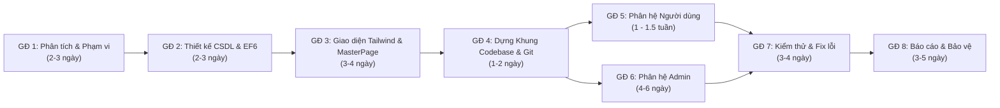

# 02. LỘ TRÌNH 8 GIAI ĐOẠN TRIỂN KHAI DỰ ÁN (ROADMAP CHO CẢ NHÓM)
**Dự án:** Website Bán Quần Áo Thời Trang (ASP.NET Web Forms + Entity Framework 6 + Tailwind CSS)  
**Mục tiêu của tài liệu:** Giúp cả 4 thành viên nắm rõ tiến độ chung, đầu ra (Deliverables) bắt buộc của từng giai đoạn và sự phụ thuộc giữa các phần việc.

---

## Sơ đồ Tổng quan Tiến độ 8 Giai đoạn

> **Điểm mấu chốt khi làm nhóm 4 người:** Ngay sau khi **Team Lead** hoàn thành **Giai đoạn 4 (Dựng khung dự án + EF6 `ShopDbContext` + `Site.Master` & `Admin.Master`)**, cả nhóm sẽ **chạy song song Giai đoạn 5 (Người dùng) và Giai đoạn 6 (Admin)** trên các nhánh Git riêng biệt để rút ngắn một nửa thời gian làm bài.

---

## Chi tiết từng Giai đoạn

### Giai đoạn 1: Phân tích yêu cầu và phạm vi (2 - 3 ngày)
**Mục tiêu:** Chốt danh sách chức năng MVP (bắt buộc chạy được) và chức năng mở rộng để không bị lan man khi code.

- **Công việc cần làm:**
  1. Thống nhất 3 vai trò người dùng: **Khách (Guest)**, **Khách hàng (Customer)**, **Quản trị viên (Admin)**.
  2. Vẽ sơ đồ Use Case tổng quát và Use Case phân rã cho 3 phân hệ (Mua sắm, Tài khoản & Đặt hàng, Quản trị).
  3. Chốt quy tắc nghiệp vụ quan trọng của shop quần áo:
     - Khách xem sản phẩm phải chọn **Màu sắc + Kích cỡ (Size)** trước khi bấm "Thêm vào giỏ".
     - Giỏ hàng lưu trong `Session["Cart"]` để khách chưa đăng nhập vẫn chọn đồ được; khi bấm "Thanh toán" mới yêu cầu đăng nhập (hoặc cho điền thông tin).
- **Sản phẩm bàn giao (Deliverables):**
  - Tài liệu `01_TONG_QUAN_DU_AN.md` (Đã hoàn thành).
  - Sơ đồ Use Case để đưa vào Chương 2 của Báo cáo Word.

---

### Giai đoạn 2: Thiết kế Cơ sở dữ liệu & Entity Framework 6 (2 - 3 ngày)
**Mục tiêu:** Xây dựng CSDL chuẩn 3NF xử lý được bài toán biến thể Size/Màu của quần áo và ánh xạ sang các lớp Entity của EF6.

- **Công việc cần làm:**
  1. Thiết kế 7 bảng cốt lõi:
     - `Users` (Khách hàng & Admin, mật khẩu lưu dạng băm `PasswordHash`).
     - `Categories` (Danh mục quần áo: Áo thun, Áo sơ mi, Áo khoác, Quần Jeans, Quần dài, Quần short, Phụ kiện, Sale).
     - `Products` (Thông tin chung của mẫu áo/quần, giá gốc, giá sale, ảnh đại diện).
     - `ProductVariants` (**Bảng trọng tâm:** `ProductID`, `ColorName`, `SizeName`, `StockQuantity`, `SKU`).
     - `ProductImages` (Ảnh phụ của sản phẩm).
     - `Orders` (Thông tin người nhận, tổng tiền, trạng thái đơn: `Pending`, `Shipping`, `Completed`, `Cancelled`).
     - `OrderDetails` (Chi tiết đơn hàng, nối với `VariantID`, lưu số lượng và đơn giá tại thời điểm mua).
  2. Viết các lớp Model C# với Data Annotations (`[Key]`, `[Required]`, `[StringLength]`, `[ForeignKey]`) và lớp `ShopDbContext : DbContext`.
  3. Tạo dữ liệu mẫu (Seed Data / Script `Database/InitShopDB.sql`) gồm **24 - 30 sản phẩm có ảnh thật**, mỗi sản phẩm có sẵn 3-4 biến thể Size/Màu.
- **Sản phẩm bàn giao (Deliverables):**
  - Sơ đồ ERD chuẩn.
  - Thư mục `Models/` với `ShopDbContext.cs` và `Database/InitShopDB.sql`.

---

### Giai đoạn 3: Thiết kế Giao diện với Tailwind CSS (3 - 4 ngày)
**Mục tiêu:** Thay thế hoàn toàn Bootstrap bằng **Tailwind CSS** để tái hiện giao diện thời trang tối giản, hiện đại giống **NOVA.VN**.

- **Công việc cần làm:**
  1. Phác thảo bố cục (Wireframe) cho 7 màn hình chính:
     - Trang chủ (`Default.aspx`)
     - Danh sách sản phẩm & Bộ lọc (`Products.aspx`)
     - Chi tiết sản phẩm & Chọn Size/Màu (`ProductDetail.aspx`)
     - Giỏ hàng (`Cart.aspx`) & Thanh toán (`Checkout.aspx`)
     - Đăng nhập / Đăng ký (`Login.aspx`, `Register.aspx`)
     - Trang quản trị Admin (`Admin/*`)
  2. Thiết lập **Tailwind CSS** trong `Site.Master` và `Admin.Master`:
     - Cấu hình bảng màu tối giản (Đen `#111111`, Trắng `#FFFFFF`, Xám nhạt `#F5F5F5`, Đỏ Sale `#E50914`).
     - Cấu hình bộ font: `Playfair Display` (cho tiêu đề Hero lớn kiểu NOVA) và `Inter` (cho menu, nội dung và giá tiền).
  3. Thiết kế Header cố định (`sticky top-0 z-50 bg-white border-b`) có thanh menu danh mục ngang, ô tìm kiếm nhanh, icon tài khoản và giỏ hàng.
- **Sản phẩm bàn giao (Deliverables):**
  - Bộ giao diện khung `Site.Master` và `Admin.Master` chạy mượt trên cả Desktop và Mobile (Responsive).

---

### Giai đoạn 4: Dựng Khung Dự án (Base Project) & Đẩy lên Git (1 - 2 ngày)
**Mục tiêu:** Team Lead tạo bộ khung chuẩn chỉnh, chạy lên không lỗi, kết nối sẵn EF6 và đẩy lên nhánh `main` / `develop` trước khi chia cho 3 thành viên còn lại kéo về code.

- **Công việc cần làm (Do Team Lead thực hiện):**
  1. Tạo project ASP.NET Web Forms, cài đặt gói NuGet `EntityFramework` (v6.4.4).
  2. Cấu hình `connectionStrings` trong `Web.config`.
  3. Tạo sẵn **tất cả các file `.aspx` rỗng** đã gắn `MasterPageFile="~/Site.Master"` hoặc `~/Admin/Admin.Master` trong Solution (để các thành viên sau này chỉ việc code nội dung bên trong file `.aspx` và `.aspx.cs` của mình, **không ai phải sửa file `.csproj` gây conflict trên Git**).
  4. Hoàn thiện menu danh mục động trên `Site.Master` lấy từ `ShopDbContext.Categories`.
- **Sản phẩm bàn giao (Deliverables):**
  - Repository Git có nhánh `main` và `develop` chạy được ngay khi clone về máy và mở bằng Visual Studio.

---

### Giai đoạn 5: Phát triển Phân hệ Người dùng (1 - 1.5 tuần)
**Mục tiêu:** Hoàn thiện toàn bộ luồng trải nghiệm mua sắm của Khách và Khách hàng theo đúng thứ tự phụ thuộc.

- **Thứ tự triển khai:**
  1. **Nhóm trang Khám phá sản phẩm (`Default.aspx`, `Products.aspx`):**
     - Dùng `<asp:Repeater>` hiển thị lưới sản phẩm 4 cột bằng Tailwind (`grid grid-cols-2 lg:grid-cols-4 gap-6`).
     - Lọc sản phẩm theo danh mục (`?cat=id`), lọc sản phẩm giảm giá (`?sale=1`), tìm kiếm theo tên (`?kw=...`), sắp xếp và phân trang.
  2. **Trang Chi tiết sản phẩm (`ProductDetail.aspx`):**
     - Load thông tin sản phẩm + danh sách `ProductVariants` qua EF6 (`.Include(p => p.Variants)`).
     - Cho phép người dùng chọn Màu sắc & Size, kiểm tra tồn kho (`StockQuantity > 0`), chọn số lượng và bấm **"Thêm vào giỏ hàng"**.
  3. **Nhóm trang Tài khoản (`Register.aspx`, `Login.aspx`):**
     - Kiểm tra hợp lệ dữ liệu nhập (Validation).
     - Băm mật khẩu bằng `SHA-256` (`AuthService.HashPassword`), lưu thông tin đăng nhập vào `Session["User"]`.
  4. **Nhóm trang Giỏ hàng & Đặt hàng (`Cart.aspx`, `Checkout.aspx`, `MyOrders.aspx`):**
     - Giỏ hàng `Session["Cart"]`: Tăng/giảm số lượng, xóa sản phẩm, hiển thị tổng tiền.
     - Đặt hàng (`Checkout.aspx`): Dùng `using (var transaction = db.Database.BeginTransaction())` của EF6 để lưu `Order`, lưu danh sách `OrderDetails`, đồng thời trừ `StockQuantity` của từng `ProductVariant`.
     - Lịch sử đơn hàng (`MyOrders.aspx`): Khách xem lại các đơn đã đặt của riêng mình và trạng thái hiện tại.

---

### Giai đoạn 6: Phát triển Phân hệ Admin (4 - 6 ngày, chạy song song GĐ 5)
**Mục tiêu:** Xây dựng khu vực quản trị chuyên nghiệp cho chủ shop bằng Tailwind CSS + EF6.

- **Thứ tự triển khai:**
  1. **Phân quyền truy cập (`Admin/Admin.Master.cs`):**
     - Kiểm tra trong `Page_Init`: Nếu `Session["User"] == null` hoặc `Role != "Admin"` thì chặn ngay và chuyển hướng về `/Login.aspx`.
  2. **Quản lý Danh mục (`Admin/Categories.aspx`) & Sản phẩm (`Admin/Products.aspx`):**
     - Thêm / Sửa / Xóa (hoặc Ẩn) danh mục và sản phẩm bằng EF6 (`db.Products.Add(...)`, `db.SaveChanges()`).
     - Hỗ trợ upload ảnh sản phẩm bằng `<asp:FileUpload>`, lưu file vào `/Assets/images/products/`.
  3. **Quản lý Biến thể Size/Màu (`Admin/ProductVariants.aspx`):**
     - Cho phép Admin thêm các dòng Size (`S, M, L, XL`) + Màu sắc + Số lượng tồn kho cho từng mẫu quần áo.
  4. **Quản lý Đơn hàng (`Admin/Orders.aspx`) & Thống kê (`Admin/Default.aspx`):**
     - Xem danh sách đơn hàng, lọc theo trạng thái, xem chi tiết các món trong đơn.
     - Đổi trạng thái đơn: *Chờ xử lý (`Pending`)* → *Đang giao (`Shipping`)* → *Hoàn thành (`Completed`)* hoặc *Hủy (`Cancelled` - hoàn lại tồn kho)*.
     - Thống kê tổng doanh thu tháng, tổng số đơn thành công, số sản phẩm đang bán.

---

### Giai đoạn 7: Kiểm thử tích hợp & Sửa lỗi (3 - 4 ngày)
**Mục tiêu:** Ghép toàn bộ code của 4 thành viên trên nhánh `develop`, chạy thử nghiệm từ đầu đến cuối và quét sạch các lỗi giảng viên hay hỏi khi chấm bài.

- **Kịch bản kiểm thử bắt buộc (End-to-End Test):**
  1. **Luồng 1 (Mua hàng chuẩn):** Khách vào trang chủ → Tìm kiếm "Áo thun" → Vào chi tiết chọn Màu Đen, Size L (đang tồn kho 10) → Thêm 2 cái vào giỏ → Đăng ký tài khoản mới → Đặt hàng → Kiểm tra tồn kho giảm còn 8.
  2. **Luồng 2 (Admin xử lý):** Đăng nhập tài khoản Admin → Vào Quản lý đơn hàng thấy đơn vừa đặt → Đổi trạng thái sang "Đang giao" rồi "Hoàn thành" → Kiểm tra Dashboard doanh thu tăng lên đúng bằng tổng tiền đơn hàng.
  3. **Luồng 3 (Kiểm tra lỗi & Bảo mật):**
     - Thử đặt hàng khi giỏ hàng đang trống (`Session["Cart"]` rỗng).
     - Thử nhập số lượng mua lớn hơn số lượng tồn kho.
     - Thử dùng tài khoản Khách hàng (`Role = "Customer"`) gõ thẳng đường dẫn `/Admin/Products.aspx` trên trình duyệt.
     - Kiểm tra bảng `Users` trong SQL Server để chắc chắn 100% mật khẩu đã được băm SHA-256.

---

### Giai đoạn 8: Hoàn thiện Báo cáo, Slide & Bảo vệ (3 - 5 ngày)
**Mục tiêu:** Chuẩn bị tài liệu chỉn chu và kịch bản demo mượt mà để cả nhóm đạt điểm tối đa.

- **Công việc cần làm:**
  1. **Viết báo cáo Word:** Tổng hợp từ các file Markdown của dự án (Phân tích yêu cầu, Sơ đồ Use Case, Sơ đồ ERD, Giải thích kiến trúc EF6 + Tailwind CSS, Chụp ảnh màn hình các chức năng).
  2. **Chuẩn bị gói nộp bài:**
     - Source code sạch (đã xóa thư mục `bin/`, `obj/` thừa hoặc đóng gói `.zip`).
     - File script `Database/InitShopDB.sql` + File backup `.bak` của SQL Server có sẵn 25-30 sản phẩm quần áo có ảnh đẹp.
     - Danh sách tài khoản test ghi rõ trong file `README.md` (1 tài khoản Admin, 2 tài khoản Khách hàng).
  3. **Tập dượt kịch bản bảo vệ:** Mỗi thành viên nắm vững phần code mình phụ trách (biết rõ file `.aspx.cs` của mình gọi hàm LINQ/EF6 nào để trả lời câu hỏi vấn đáp của giảng viên).
