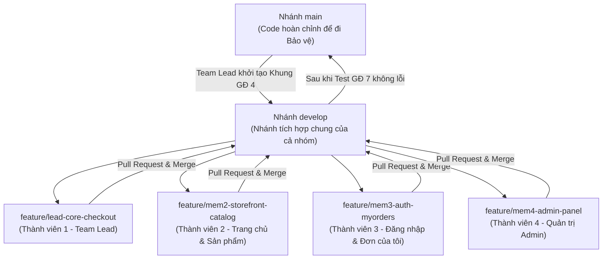

# 03. PHÂN CÔNG CÔNG VIỆC (4 NGƯỜI) & NGUYÊN TẮC LÀM VIỆC VỚI GIT
**Dự án:** Website Bán Quần Áo Thời Trang (ASP.NET Web Forms + Entity Framework 6 + Tailwind CSS)  
**Mô hình nhóm:** 4 Thành viên — **Thành viên 1 (Bạn - Team Lead / Quản lý)** gánh phần khung kiến trúc, CSDL, EF6 Core và luồng khó nhất; **3 Thành viên còn lại** phụ trách 3 mảng độc lập.

---

## 1. Nguyên tắc Chia việc để Không Giẫm Chân Lên Nhau trên Git

Trong dự án **ASP.NET Web Forms**, xung đột Git (Merge Conflict) kinh khủng nhất xảy ra khi:
1. Nhiều người cùng thêm/xóa file trong Visual Studio làm hỏng file **`.csproj`**.
2. Nhiều người cùng sửa file **`Web.config`** hoặc **`Models/ShopDbContext.cs`**.
3. Nhiều người cùng sửa chung một trang `.aspx`.

**Giải pháp của nhóm chúng ta:**
- **Team Lead (Bạn)** sẽ khởi tạo sẵn **100% khung file `.aspx` rỗng**, cấu hình xong `Web.config`, toàn bộ thư mục `Models/` (EF6 Entities + `ShopDbContext`), `Site.Master` và `Admin.Master` ngay ở **Giai đoạn 4**, rồi mới push lên Git.
- Sau đó, **mỗi thành viên chỉ được phép mở và code vào đúng các file `.aspx`, `.aspx.cs` và file `Service` được giao cho mình**. Không ai (ngoài Team Lead) được tự ý sửa `Web.config`, `.csproj`, hay các class trong `Models/`.

---

## 2. Bảng Phân Công Chi Tiết Cho 4 Thành Viên

| Thành viên | Vai trò & Khối lượng | Các Module & Chức năng phụ trách | Danh sách File ĐƯỢC PHÉP SỬA (File Ownership) |
| :--- | :--- | :--- | :--- |
| **Thành viên 1 (BẠN)**<br>**Team Lead / Architect** | **~35% - 40%**<br>*(Gánh phần khung, EF6, MasterPage & Luồng Đặt hàng phức tạp nhất)* | 1. **Thiết kế CSDL & EF6:** Tạo bảng SQL, viết toàn bộ `Models/` (`ShopDbContext`, Entities, Seed Data 25 sản phẩm mẫu).<br>2. **Dựng Khung Giao diện Tailwind:** Code `Site.Master` (Header NOVA.VN, menu động, badge giỏ hàng) và `Admin/Admin.Master` (Sidebar + chặn phân quyền Admin).<br>3. **Luồng Giỏ hàng & Đặt hàng (Transaction):** Xử lý `Session["Cart"]`, trang `Cart.aspx`, trang `Checkout.aspx` (Lưu `Order` + `OrderDetails` + trừ tồn kho `ProductVariants` bằng EF6 Transaction).<br>4. **Review Pull Request & Merge Git.** | - `Web.config`, `Global.asax`, `*.csproj`<br>- `Database/InitShopDB.sql`<br>- Toàn bộ thư mục `Models/*`<br>- `Site.Master`, `Site.Master.cs`<br>- `Admin/Admin.Master`, `Admin/Admin.Master.cs`<br>- `Services/CartService.cs`, `Services/OrderService.cs`<br>- `Cart.aspx`, `Cart.aspx.cs`<br>- `Checkout.aspx`, `Checkout.aspx.cs` |
| **Thành viên 2**<br>**Storefront & Catalog Dev** | **~20%**<br>*(Chuyên giao diện khách hàng & truy vấn hiển thị sản phẩm)* | 1. **Trang chủ (`Default.aspx`):** Cắt giao diện Tailwind chuẩn ảnh mẫu NOVA.VN (Khối Hero Serif, 3 Banner chiến dịch lớn, Lưới sản phẩm Mới & Nổi bật).<br>2. **Danh sách sản phẩm (`Products.aspx`):** Lọc sản phẩm theo Danh mục (`?cat=`), lọc đồ `SALE` (`?sale=1`), Tìm kiếm theo từ khóa (`?kw=`), Sắp xếp theo giá và Phân trang.<br>3. **Chi tiết sản phẩm (`ProductDetail.aspx`):** Hiển thị ảnh sản phẩm, mô tả, load danh sách biến thể **Màu sắc & Size (`S/M/L/XL`)**, kiểm tra tồn kho và gọi hàm thêm vào giỏ hàng. | - `Services/CatalogService.cs`<br>- `Default.aspx`, `Default.aspx.cs`<br>- `Products.aspx`, `Products.aspx.cs`<br>- `ProductDetail.aspx`, `ProductDetail.aspx.cs`<br>- `Assets/css/custom.css`<br>- `Assets/js/main.js` |
| **Thành viên 3**<br>**Auth & Customer Portal Dev** | **~20%**<br>*(Chuyên tài khoản, bảo mật & lịch sử đơn hàng của khách)* | 1. **Đăng ký (`Register.aspx`):** Form Tailwind + Validation (Email, SĐT, Mật khẩu khớp nhau), kiểm tra trùng Email bằng EF6, băm mật khẩu `SHA-256`.<br>2. **Đăng nhập / Đăng xuất (`Login.aspx`):** Đối chiếu tài khoản qua EF6, lưu `Session["User"]`, tự động điều hướng Admin vào `/Admin/Default.aspx` và Khách về trang trước đó (`returnUrl`).<br>3. **Lịch sử đơn hàng (`MyOrders.aspx`):** Hiển thị danh sách đơn hàng của khách đang đăng nhập, xem chi tiết các món (Size/Màu) trong đơn, và nút **"Hủy đơn hàng"** (nếu đơn đang ở trạng thái `Pending`). | - `Services/AuthService.cs`<br>- `Login.aspx`, `Login.aspx.cs`<br>- `Register.aspx`, `Register.aspx.cs`<br>- `MyOrders.aspx`, `MyOrders.aspx.cs` |
| **Thành viên 4**<br>**Admin Panel & Dashboard Dev** | **~20%**<br>*(Chuyên toàn bộ trang Quản trị hệ thống)* | 1. **CRUD Danh mục (`Admin/Categories.aspx`):** Thêm, sửa, ẩn/hiện, sắp xếp thứ tự danh mục trên menu.<br>2. **CRUD Sản phẩm (`Admin/Products.aspx`):** Danh sách sản phẩm, thêm/sửa sản phẩm kèm **Upload ảnh** vào `/Assets/images/products/`.<br>3. **Quản lý Biến thể Size/Màu (`Admin/ProductVariants.aspx`):** Thêm/sửa/xóa các dòng Size (`S, M, L, XL`), Màu sắc và Số lượng tồn kho của từng sản phẩm.<br>4. **Quản lý Đơn hàng (`Admin/Orders.aspx`) & Dashboard (`Admin/Default.aspx`):** Lọc đơn, đổi trạng thái đơn (*Chờ xử lý → Đang giao → Hoàn thành / Hủy*), thống kê tổng doanh thu & số đơn. | - `Admin/Default.aspx`, `Admin/Default.aspx.cs`<br>- `Admin/Categories.aspx`, `Admin/Categories.aspx.cs`<br>- `Admin/Products.aspx`, `Admin/Products.aspx.cs`<br>- `Admin/ProductVariants.aspx`, `Admin/ProductVariants.aspx.cs`<br>- `Admin/Orders.aspx`, `Admin/Orders.aspx.cs` |

---

## 3. Sơ đồ Luồng Phối Hợp & Nhánh Git (Git Branching Workflow)



---

## 4. Nội quy Làm việc với Git (Bắt buộc cả 4 người tuân thủ)

### Quy tắc 1: Cấu trúc Nhánh (Branches)
1. **`main`**: Nhánh thiêng liêng, chỉ chứa code chạy ổn định 100% để mang đi báo cáo/bảo vệ. **Cấm push trực tiếp lên `main`.**
2. **`develop`**: Nhánh ghép code chung của 4 anh em.
3. **Nhánh cá nhân (`feature/...`)**: Mỗi thành viên làm việc trên nhánh riêng của mình:
   - Thành viên 1 (Lead): `feature/lead-core-checkout`
   - Thành viên 2: `feature/mem2-storefront-catalog`
   - Thành viên 3: `feature/mem3-auth-myorders`
   - Thành viên 4: `feature/mem4-admin-panel`

### Quy tắc 2: Ranh giới File ("Ai được sửa cái gì?")
- **TUYỆT ĐỐI KHÔNG SỬA FILE CỦA NGƯỜI KHÁC.** Hãy nhìn cột *"Danh sách File ĐƯỢC PHÉP SỬA"* ở Mục 2 trước khi code.
- **CÁC FILE CẤM SỬA (Chỉ Team Lead được chạm vào):**
  - `Web.config`
  - File Solution (`.sln`) và File Project (`.csproj`)
  - Toàn bộ thư mục `Models/` (`ShopDbContext.cs`, `Product.cs`, `Order.cs`...)
  - `Site.Master` và `Admin/Admin.Master`
- **Nếu Thành viên 2, 3, 4 cần thêm 1 trường dữ liệu, cần thêm 1 trang `.aspx` mới, hoặc cần sửa menu trên `Site.Master`:**
  - Nhắn tin vào group chat cho **Team Lead (Bạn)**.
  - Team Lead sẽ sửa trên `develop`, push lên, và báo cả nhóm `git pull origin develop` về. Cách này đảm bảo **0% xung đột file hệ thống**.

### Quy tắc 3: File `.gitignore` bắt buộc phải có
Để không đẩy các file rác của Visual Studio và SQL Server lên làm hỏng máy người khác, file `.gitignore` ở thư mục gốc sẽ chặn:
- Thư mục biên dịch: `bin/`, `obj/`, `.vs/`
- File cấu hình máy cá nhân: `*.user`, `*.suo`, `App_Data/*.mdf`, `App_Data/*.ldf`
- Thư mục `packages/` (Visual Studio sẽ tự khôi phục qua NuGet Restore dựa trên `packages.config`).
- **Xử lý chuỗi kết nối SQL Server (`Web.config`):** Cả nhóm thống nhất dùng chung tên Server là `.\SQLEXPRESS` hoặc `(localdb)\MSSQLLocalDB` với `Integrated Security=True` để không ai phải sửa `Web.config` trên máy mình.

### Quy tắc 4: Quy trình 5 bước mỗi ngày khi ngồi vào code

1. **Bước 1 — Kéo code mới nhất từ nhánh `develop` về trước khi làm:**
   ```bash
   git checkout your-feature-branch
   git pull origin develop
   ```
2. **Bước 2 — Code đúng trong các file được phân công & Build thử (`Ctrl + Shift + B` trong Visual Studio):**
   - Quy tắc vàng: **Code không Build thành công thì cấm Commit/Push.**
3. **Bước 3 — Kiểm tra danh sách file vừa chạm vào trước khi Commit:**
   ```bash
   git status
   ```
   *(Nếu thấy lỡ dính file `Web.config` hoặc `.csproj` mà mình không được phép sửa, hãy chạy `git checkout -- Web.config` để hoàn tác file đó về như cũ).*
4. **Bước 4 — Commit với thông điệp rõ ràng:**
   ```bash
   git add <tên-các-file-của-mình>
   git commit -m "feat(catalog): hoan thien loc san pham theo danh muc va tim kiem"
   git push origin your-feature-branch
   ```
5. **Bước 5 — Tạo Pull Request (PR) vào nhánh `develop`:**
   - Gắn thẻ **Team Lead (Bạn)** vào review và bấm Merge.

---

## 5. Quy chuẩn Code chung cho Cả Nhóm (Coding Conventions)

Để code của 4 người ghép lại nhìn như 1 người viết:

1. **Truy vấn Entity Framework 6 (`ShopDbContext`):**
   - Luôn khởi tạo `ShopDbContext` trong khối `using` để tự động đóng kết nối CSDL:
     ```csharp
     using (var db = new ShopDbContext())
     {
         var products = db.Products
                          .Include(p => p.Category)
                          .Where(p => p.IsActive)
                          .OrderByDescending(p => p.CreatedAt)
                          .ToList();
     }
     ```
2. **Giao diện Tailwind CSS:**
   - Không viết `<style>` lộn xộn trong từng trang `.aspx` và không dùng Bootstrap class (`container`, `row`, `col-md-4`, `btn-primary`).
   - Sử dụng thống nhất các class Tailwind:
     - Khung căn giữa: `max-w-7xl mx-auto px-4 sm:px-6 lg:px-8`
     - Lưới 4 sản phẩm: `grid grid-cols-2 md:grid-cols-3 lg:grid-cols-4 gap-6`
     - Nút bấm chính (kiểu NOVA): `bg-neutral-900 text-white hover:bg-neutral-700 px-6 py-3 text-sm font-medium uppercase tracking-wider transition`
     - Nút bấm phụ: `border border-neutral-900 text-neutral-900 hover:bg-neutral-100 px-6 py-3 text-sm font-medium uppercase tracking-wider transition`
3. **Đặt tên ID cho Server Controls:**
   - `rpt...` cho `Repeater` (ví dụ: `rptProducts`, `rptVariants`)
   - `txt...` cho `TextBox` (`txtEmail`, `txtSearch`)
   - `ddl...` cho `DropDownList` (`ddlCategory`, `ddlOrderStatus`)
   - `btn...` cho `Button` / `LinkButton` (`btnAddToCart`, `btnCheckout`)
   - `lbl...` cho `Label` / `Literal` (`lblMessage`, `litTotalAmount`)
